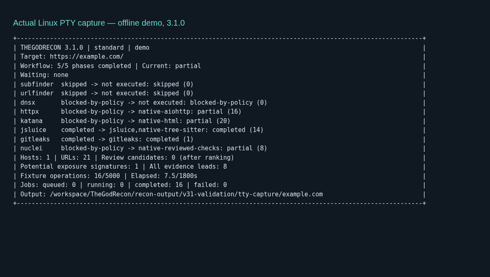
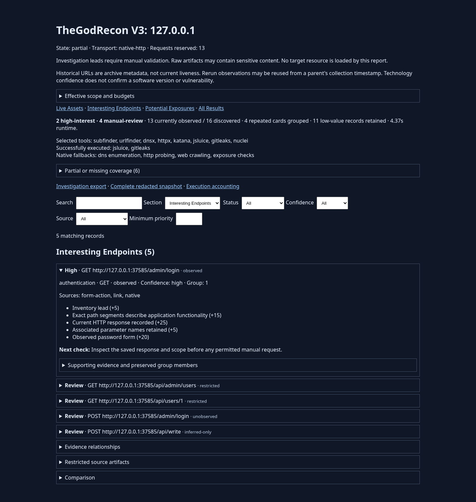

# TheGodRecon 3.1.0

Usability release on merged V3, without changing SQLite schema 3, policy revision 2, YAML versions 1/2 or scoring rules. Existing runs remain readable. No new Python runtime dependency was added; pip hash locks are unchanged and uv's local project version is updated.

## CLI and settings

`scan TARGET` and existing `scan --target TARGET --config FILE` share `effective_config` and the existing selection resolver. The default uses `default_config`, exact-host scope and bounded existing budgets. `--all-tool` / `--all-tools` maps to `--tools all`; conflicting explicit selections fail before run allocation. The underlying eight permanent IDs and native fallback behavior are unchanged.

| Preset | HTTP ceiling | URLs/host | Depth | Minutes | Selection |
|---|---:|---:|---:|---:|---|
| quick | 100 | 50 | 1 | 5 | Native HTTP, HTML and analysis |
| standard | 5000 | 500 | 2 | 30 | Existing native default, including reviewed exposure checks |
| deep | 10000 | 1500 | 4 | 60 | Native capabilities plus selected jsluice/Gitleaks, local technology/grouping/ranking |

Presets never add scope or metadata providers. Explicit budget flags override preset budgets. Saved preset defaults apply only to new scans without YAML. Combining a preset with YAML, resume or advanced `--profile` is rejected. YAML settings and advanced profiles retain their existing meaning. `--all-tool` itself uses precisely the existing provider selection and policy, with no new providers or enrichments.

Settings are JSON in `$XDG_CONFIG_HOME/thegodrecon/settings.json` (default `~/.config/thegodrecon`) or `%APPDATA%\thegodrecon\settings.json`. Optional `RECONMAP_CONFIG_DIR` selects a portable/test settings directory. No credentials or scan evidence belong here. Supported edits: `reconmap settings --set preset quick`, `--set output_root PATH`, `--set auto_open true`, `--set progress false`. Saved output roots are absolute; the unsaved default remains `./recon-output`. Rerun's default child folder remains adjacent to its parent.

Tool path precedence is explicit CLI override, scan YAML path, registered user path, managed directory, then PATH. There is no filesystem-wide search. Registration remembers a path without granting trust. A missing or incompatible registered path is diagnosed, not silently replaced. `reconmap tools unregister NAME` forgets the override without deleting the custom executable; run setup again to use a managed installation. Changing an executable identity still prevents unsafe resume.

## Installation and repair

`python tools/bootstrap.py` creates/reuses `.venv`, runs hash-pinned requirements installation and a local editable package installation, then calls the shared setup manager. No pip build hook downloads external tools. The project launchers handle paths with spaces/Unicode without modifying shell profiles or PATH.

Managed binaries default to `$XDG_DATA_HOME/thegodrecon/tools/bin` (usually `~/.local/share/...`) or `%LOCALAPPDATA%\thegodrecon\tools\bin`. Use bootstrap/setup `--directory PATH` for portable installations. `--skip-tools` installs/checks the Python core without downloading tools; optional coverage remains partial. `setup` and `doctor --fix` request consent in a TTY or require `--yes` in automation. Bootstrap itself is the explicit installation request and passes `--yes`.

Seven official release binaries use the shared installer: Subfinder 2.17.0, URLFinder 0.0.3, dnsx 1.3.1, ProjectDiscovery httpx 1.12.0, Katana 1.8.0, Gitleaks 8.30.1 and Nuclei 3.11.1. Linux/Windows x86-64 archive selection is supported. Downloads and extracted files are capped; official checksums are required. Complete binaries publish atomically without replacing different existing files. Existing receipts and binary hashes avoid downloads on repeat installation; setup additionally reruns adapter version/flag checks. Incompatible custom binaries require explicit user maintenance. Core dependency repairs use bootstrap; a broken Python installation may need the user's OS package manager.

Active binary policy blocks are execution restrictions, not installation failures. Missing/failed optional installation returns 2 and retains applicable native capabilities; configuration/bootstrap failures return 3. Doctor returns 0 for an available core while reporting optional coverage separately. Strict scan dependency failure remains 4; interrupted scans remain 130.

## jsluice source build and fallback

The old hash pinned one particular C/Go build. Compiler, Go version, embedded paths and linking choices change the executable SHA-256 even from identical source. Help output alone cannot establish source identity.

The reviewed recipe downloads BishopFox/jsluice revision `0ddfab153e060a9eeaded4d8669233f7c071e7e4` from the official source archive and requires SHA-256 `9a5db8164f2cbbf99ead65f83926e3a169df9b1570e00dfee097f896c70db078`. It bounds extraction, rejects links/traversal, preserves `go.mod`/`go.sum`, requires dependency verification with Go's checksum database enabled, uses readonly module resolution and local toolchains, compiles with `-trimpath -buildvcs=false`, checks capabilities and executes a controlled local `fetch` fixture before recording the binary fingerprint.

Go 1.20+ and a GCC C toolchain must already exist. Neither is installed with administrator privileges. Supply `--go` and `--cc` when they are outside PATH. Build output is bounded and timed; child processes are killed on timeout/cancellation. Missing compilers, unsupported architecture, source mismatch or failed behavior checks leave Tree-sitter available.

Build attestation is stored separately from user path registration in private `jsluice-build.json`; it binds the resulting hash to the exact path, pinned source and verified recipe. Unknown hashes are refused **before even executing help**. Every later adapter invocation retains SHA-256 rechecking. This prevents accidental/unreviewed binary replacement; it does not claim protection from an attacker who already controls the same OS account and application files. Existing reviewed static fingerprints remain supported.

Secondary analyzer evaluation: xnLinkFinder HEAD `841ac8dddbc7edd728939df5db51274a63ab5863` was inspected via its official README and setup source on 2026-10-16. It documents local directory/file extraction, but its broad unpinned dependency set (including Playwright/PDF tooling), setup-time user configuration writes and crawling modes need an independent dependency/containment review. Maintenance and a safe pinned install were not established by this inspection. It was not installed, executed or integrated. The supported order is **verified jsluice → native Tree-sitter**. No unverified alternative is advertised. Registry ID 6 and actual analyzer provenance remain intact. Secret detection remains its own selected capability.

## Terminal and reports

The stdlib dashboard observes existing SQLite stage results, jobs and counters. It reports completed applicable workflow phases separately from consumed budgets; dynamic discovery is never shown as a fabricated completion percentage. Primary status and actual engine remain separate, including native fallback, policy blocks and partial work. Captured demo operations are labeled as fixtures, not real HTTP traffic. Candidate counts become available after ranking.

TTY mode uses a compact redraw with ASCII borders, terminal-safe text and cursor restoration. Windows virtual-terminal support is checked; unsupported/dumb terminals fall back to plain logs. `--no-progress` and redirected stdout use line logs. JSON diagnostics and plans never instantiate the dashboard. Ctrl+C preserves the existing cancellation/checkpoint/report flow and prints the resumable run location.

`reconmap` opens a guided menu only with both stdin/stdout TTY. Guided scans preview scope and budgets and require a start choice. All operations use the same CLI. `report` searches only immediate children of known output roots plus the saved last run, verifies manifest/config/database identity, then opens an existing report without regenerating it. `report --run PATH` retains explicit regeneration; add `--open` to open it. Browser failure/headless operation prints the absolute path and never changes scan status. Automatic opening is opt-in.

## Verification

Validation results and exact retained output paths are recorded below when complete. Native Windows execution and actual Windows tool builds must not be inferred from Linux path simulations or the CI definition. No public target/provider reconnaissance is used for release validation.

Executed on 2026-10-16:

| Check | Result |
|---|---|
| Linux Python 3.12.14, real reviewed offline tool bindings | **318 passed**, 0 failures/skips, 15.15s |
| Linux Python 3.13.5, same bindings | **318 passed**, 0 failures/skips, 15.38s |
| Fresh bootstrap, project/settings/tool paths with spaces and Unicode | Passed: locked Python install, seven official releases, jsluice source build, all eight adapter checks |
| Repeat bootstrap and `doctor --fix --yes` | Passed; all eight compatible tools reused without tool downloads |
| `uv sync --frozen --extra test`, Python compilation, browser harness syntax, Git whitespace checks | Passed |
| Controlled localhost workflow | 13 checks passed; 13 GETs; resume/rerun issued 0 new requests; parent unchanged |
| Chromium 154.0.8037.57 / Playwright 1.62.1 | 15 checks passed; 0 browser errors; 0 external requests |
| Actual Linux PTY dashboard | 31 redraws; cursor restored; report prompt handled; honest partial status |

The source-built jsluice hash was `452e090a0040dc0b6bd36e89e008510acd449bc021a9989ea48339a7146d967c`, using Go 1.27.2 and GCC 14.2.0. It passed actual local JavaScript extraction and an offline demo integration. This is build provenance, not a universal reproducible binary promise. Release tools were installed and version/help checked; Gitleaks and jsluice performed real local processing. Public Subfinder/URLFinder collection and direct active target-tool execution were not performed.

Native Windows 10/11, PowerShell, Windows tool builds/process cleanup and console rendering remain **unexecuted here**. Windows-oriented path/archive fixtures pass on Linux, and the CI matrix covers Windows Python 3.12/3.13 including bootstrap and CLI checks; those declarations do not establish a successful Windows run. Managed Chromium blocks direct `file://` navigation, so browser checks load the actual local HTML via `setContent`.

Reproduce in an activated environment (Linux or PowerShell):

```text
python -m pytest -q
python tools/verify_local_workflow.py --output-root recon-output/my-new-verification
reconmap demo
reconmap report
```

Bind `RECONMAP_TEST_GITLEAKS` and `RECONMAP_TEST_JSLUICE` to compatible verified binaries to execute optional real-tool tests; otherwise those tests explicitly skip. On Linux: `export RECONMAP_TEST_GITLEAKS=/path/to/gitleaks`; PowerShell: `$env:RECONMAP_TEST_GITLEAKS='C:\path\gitleaks.exe'`. Static-reviewed jsluice test bindings work independently of user preferences; locally attested builds require their matching settings during real CLI runs. The browser helper and prerequisites are documented in [V3 regression notes](V3_REGRESSION.md).

Exact retained locations in this cloud workspace:

- `/workspace/TheGodRecon/recon-output/v31-validation/pytest-python312-final.xml` and `pytest-python313-final.xml`: final suite results.
- `/workspace/TheGodRecon/recon-output/v31-validation/workflow/127.0.0.1/reports/index.html`: controlled localhost report.
- `/workspace/TheGodRecon/recon-output/v31-validation/workflow/verification.json`: workflow assertions/counters.
- `/workspace/TheGodRecon/recon-output/v31-validation/browser/`: report screenshots and browser verification JSON.
- `/workspace/TheGodRecon/recon-output/v31-validation/terminal.raw.txt`, `terminal-frame.txt`, `terminal-check.log`: real PTY capture and checks. The screenshot below renders this captured frame; it is not an OS desktop screenshot.
- `/workspace/TheGodRecon/recon-output/v31-validation/bootstrap-fresh.log`, `bootstrap-repeat.log`, `doctor-fix.log`, `doctor.json`, `jsluice-source-build.log`: installation/tool verification.
- `/workspace/v31 portable ü/`: fresh installation; `/workspace/v31 portable tools/bin/`: verified tools; `/workspace/v31 portable settings/`: settings/build provenance. No executable is stored in scan evidence.




