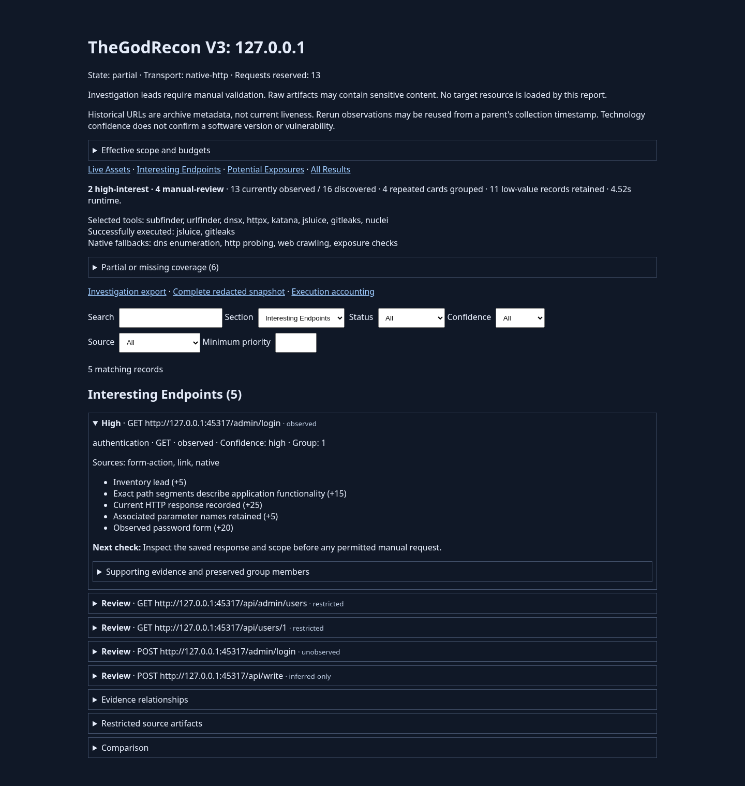
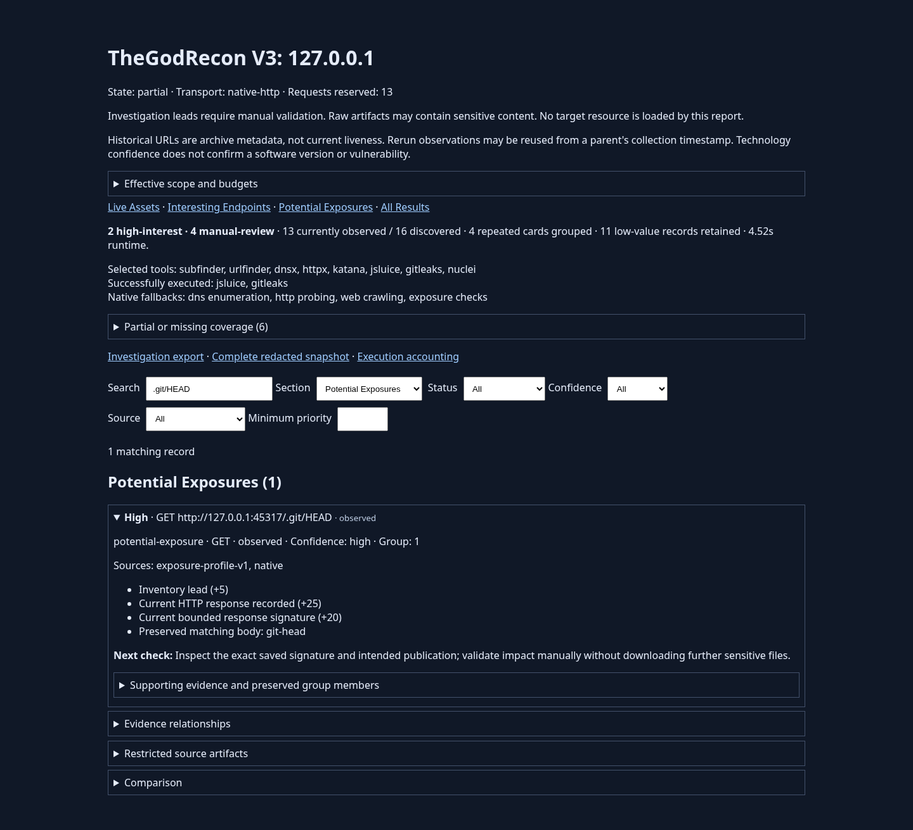

# V3 regression and browser verification — 2026-10-16

All reproducible defects found in this pass are fixed. The final suites have no
failures or skips on the two tested Linux interpreters. This is evidence for the
scenarios below, not a guarantee that the application contains no undiscovered
bugs. No public target or discovery provider was scanned.

## Defects reproduced and fixed

| Trigger | Previous behavior | Verified behavior |
| --- | --- | --- |
| Search in collapsed All Results or secondary evidence | Matching rows remained invisible | Matching ancestor sections open; empty sections hide; a visible match count explains zero results |
| Filter a source correlated with other tools | Source choices were comma-joined combinations | Each source is selectable independently and matches all supporting records |
| Structured authorization context or extension/invalid method metadata | Identity collection and evidence attachment disagreed, dropping derived endpoint evidence | Shared canonical identity rules retain evidence, distinguish contexts and preserve extension methods; invalid method data stays attached to UNKNOWN |
| Fresh response after a parent or older soft-404 observation | Old soft-404 flags suppressed new login evidence | Penalties require the current response hash and current-run evidence; old observations remain inspectable |
| Mixed-case MIME, `.JS`, `.MAP` or `.mjs` content | Static classification or JavaScript/form extraction could be missed | Media types normalize for processing; script/map suffix recognition preserves original URL case |

No request permission was broadened. Unsupported methods remain evidence only;
the existing GET/action checks still govern scheduling. Raw response headers and
observations remain preserved. Schema, dependency pins and policy revision did
not change. Older soft-404 records remain readable using their recorded identity.

## Final execution results

| Environment/check | Result |
| --- | --- |
| Linux x86-64, Python 3.12.14 | **268 passed**, 0 failed, 0 skipped; 11.89 seconds |
| Linux x86-64, Python 3.13.5 | **268 passed**, 0 failed, 0 skipped; 12.17 seconds |
| Real Gitleaks 8.30.1 and reviewed jsluice | Executed in both suites and localhost workflows |
| Scoped localhost with actual offline tools | 13 GETs, 13 workflow checks passed; zero new resume/rerun requests |
| Scoped localhost with all eight tool paths deliberately absent | 13 GETs through native fallbacks; 13 workflow checks passed |
| Chromium 154.0.8037.57 / Playwright 1.62.1 | 15 checks passed, zero browser/console errors, zero external requests |
| Python compilation, Node syntax and Git whitespace checks | Passed |
| Gitleaks review of 71 source/documentation/image files | Only the two existing deliberately synthetic demo/test tokens |

The initial 228-test baseline also passed. Forty added Python cases cover the
newly reproduced defects and CLI combinations. A targeted run without the optional
tool environment variables skipped one real-tool test; both final suites supplied
the real paths and had **no skips**. Local-tool-only demos with no captured input
correctly complete with an explicit skipped stage; they do not claim tool execution.

## Scenario coverage

| Area | Executed scenarios |
| --- | --- |
| CLI/config | All eight numbered selections; native and full demos; invalid selections/conflicting flags/unknown tool names; zero/negative/NaN/infinite budgets; YAML validation; strict missing-tool preflight |
| Output/storage | Collision sequences, occupied files/symlinks, concurrent allocation, Unicode/spaced paths, atomic writes, corrupt metadata, old-schema migration, artifact integrity |
| Scope/network | Exact/wildcard hosts, IDNA, case-sensitive paths, encoded exclusions, schemes/ports, rebinding/private IPs, out-of-scope redirects, prohibited actions and non-GET inference |
| Limits/lifecycle | Request/URL/depth/time/artifact caps, retries and Retry-After, compressed/truncated responses, subprocess timeout/output limits, changed executables, interruption/cancellation and resume |
| Tool orchestration | Missing/incompatible/crashed/malformed/partial tools, successful primary without redundant fallback, checkpoints, shared remaining budgets, explicit provider fallback opt-in; provider data used fixtures only |
| Intelligence | Static false positives, mixed-case MIME, route signatures, history/inference/parent separation, structured contexts, exact methods/query/ports, source/content/route grouping, stale soft-404s, conflicting responses |
| Reporting | Escaping, redaction, CSV safety, CSP script integrity, four views, visible filtered matches, source/confidence/status/priority controls, nested evidence, empty reports, navigation and 390px layout |
| Reruns | Parent bytes/entries preserved, no inherited liveness, zero-request offline rerun, fresh authorized localhost recollection, interrupted copying |

The browser loaded locally read HTML with Playwright `setContent`. Direct
`file://` navigation is blocked by the managed browser, so native filesystem
navigation is still unverified. Screenshots below are actual browser captures of
the controlled localhost fixture. “Partial” records skipped discovery providers
and blocked independent active binaries; useful native/local collection completed.





## Reproduce locally

From the installed repository root, the commands below work in Bash and
PowerShell when `python`/`node` refer to the desired environments. Use a new output
root each time; the workflow utility refuses to overwrite earlier runs.

```text
python -m pytest -q
python tools/verify_local_workflow.py --output-root ./recon-output/check-1
python tools/verify_local_workflow.py --output-root ./recon-output/check-2 --tool jsluice=PATH_TO_JSLUICE --tool gitleaks=PATH_TO_GITLEAKS
```

The first workflow uses native fallbacks when selected tools are unavailable.
No external executable is installed by these commands. For actual optional-tool
tests, bind their verified paths before pytest:

```bash
RECONMAP_TEST_GITLEAKS=/path/to/gitleaks RECONMAP_TEST_JSLUICE=/path/to/jsluice python -m pytest -q
```

```powershell
$env:RECONMAP_TEST_GITLEAKS = 'C:\Tools\gitleaks.exe'
$env:RECONMAP_TEST_JSLUICE = 'C:\Tools\jsluice.exe'
python -m pytest -q
```

Optional browser verification needs separately installed Playwright and Chromium;
neither is an application runtime dependency. Set `RECONMAP_PLAYWRIGHT_MODULE` to
an existing Playwright package path if normal Node resolution cannot find it, and
`RECONMAP_CHROMIUM` to an existing browser executable when needed. Then run:

```text
node tools/check_report_browser.cjs ./recon-output/check-2/127.0.0.1/reports/index.html ./recon-output/browser-check-1
```

An optional third argument supplies an empty partial report for the final empty
view check. The screenshot directory must be new. Existing reports can acquire
the fixes without collecting again: `reconmap report --run RUN_DIRECTORY`.

## Exact retained outputs

Root: `/workspace/TheGodRecon/recon-output/v3-regression/`.

- `pytest-python312-final.xml`, `pytest-python313-final.xml`: final test evidence.
- `pass-1/`: first real-tool workflow and original reports.
- `pass-2-python313/127.0.0.1/reports/index.html`: final real-tool localhost report.
- `pass-2-python313/1_127.0.0.1/reports/index.html`: its immutable-parent offline rerun.
- `pass-3-missing-tools/127.0.0.1/reports/index.html`: verified missing-tool fallback.
- Each workflow includes `demo/example.com`, `demo/1_example.com`, a one-request
  capped run under `budget/`, and `verification.json` with paths/counters/assertions.
- `empty/example.com/reports/index.html`: zero-request time-limited report.
- `screenshots-final/`: overview, shortlist, exposure and mobile PNGs plus browser
  `verification.json`. Only the two reviewed localhost screenshots under
  `docs/images/` are published; databases, raw content and logs stay excluded.

Native Windows 3.12/3.13, live providers and active-subprocess containment remain
unverified. Direct dnsx/httpx/Katana/Nuclei execution stays blocked. No claim is made
that configured GitHub Actions ran or that all possible inputs were tested.
